# Gallery

Every feature of Impressio, with the code that made each picture. The pictures are generated by `scripts/gallery.cjs`, which runs exactly the snippets shown here. Each snippet assumes:

```ts
import { createSheet, impressions, ink, typesetTex, typesetRich } from 'impressio';
```

- [Stocks](#stocks)
- [Press runs](#press-runs)
- [Press parameters](#press-parameters)
- [Inks](#inks)
- [Formes](#formes)
- [Mathematics](#mathematics)
- [Light](#light)
- [Live DOM text](#live-dom-text)
- [Also](#also)

## Stocks

Pass a name, any CSS colour, or a (partial) `PaperSpec` as `paper`.

<table>
<tr><th>Print<br>&nbsp;&nbsp;&nbsp;&nbsp;&nbsp;&nbsp;&nbsp;&nbsp;&nbsp;&nbsp;&nbsp;&nbsp;&nbsp;&nbsp;&nbsp;&nbsp;&nbsp;&nbsp;&nbsp;&nbsp;&nbsp;&nbsp;&nbsp;&nbsp;&nbsp;&nbsp;&nbsp;&nbsp;&nbsp;&nbsp;&nbsp;&nbsp;&nbsp;&nbsp;&nbsp;&nbsp;&nbsp;&nbsp;&nbsp;&nbsp;&nbsp;&nbsp;&nbsp;&nbsp;&nbsp;&nbsp;&nbsp;&nbsp;&nbsp;&nbsp;&nbsp;&nbsp;&nbsp;&nbsp;&nbsp;&nbsp;&nbsp;&nbsp;&nbsp;&nbsp;&nbsp;&nbsp;&nbsp;&nbsp;&nbsp;&nbsp;&nbsp;&nbsp;&nbsp;&nbsp;&nbsp;&nbsp;&nbsp;&nbsp;&nbsp;&nbsp;&nbsp;&nbsp;</th><th>What it shows<br>&nbsp;&nbsp;&nbsp;&nbsp;&nbsp;&nbsp;&nbsp;&nbsp;&nbsp;&nbsp;&nbsp;&nbsp;&nbsp;&nbsp;&nbsp;&nbsp;&nbsp;&nbsp;&nbsp;&nbsp;&nbsp;&nbsp;&nbsp;&nbsp;&nbsp;&nbsp;&nbsp;&nbsp;&nbsp;&nbsp;&nbsp;&nbsp;&nbsp;&nbsp;&nbsp;&nbsp;&nbsp;&nbsp;&nbsp;&nbsp;</th><th>Code</th></tr>
<tr>
<td>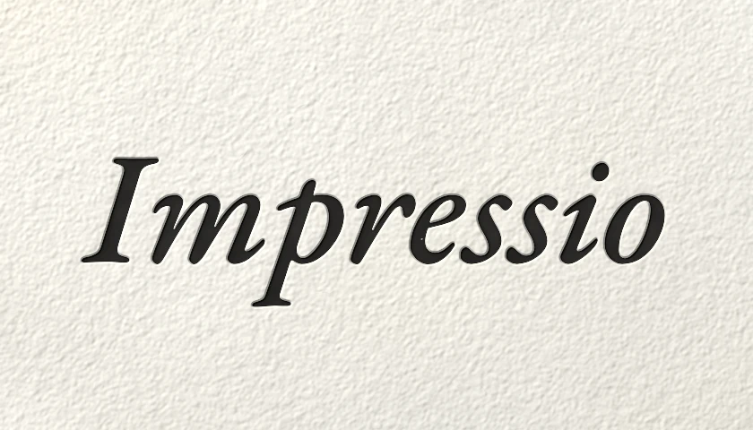</td>
<td>

**`cotton`**

Soft, toothy 100% cotton in a pearl white. The classic stock for a deep impression.

</td>
<td>

```ts
const sheet = createSheet({ width: 420,
  height: 240, paper: 'cotton', seed: 7 });
sheet.impress('deep', f =>
  f.text('Impressio', 210, 146,
  { font: 'italic 500 88px "EB Garamond"',
  align: 'center' }));
sheet.render();
```

</td>
</tr>
<tr>
<td></td>
<td>

**`cottonWhite`**

The same cotton in bright white.

</td>
<td>

```ts
const sheet = createSheet({ width: 420,
  height: 240, paper: 'cottonWhite',
  seed: 7 });
sheet.impress('deep', f =>
  f.text('Impressio', 210, 146,
  { font: 'italic 500 88px "EB Garamond"',
  align: 'center' }));
sheet.render();
```

</td>
</tr>
<tr>
<td>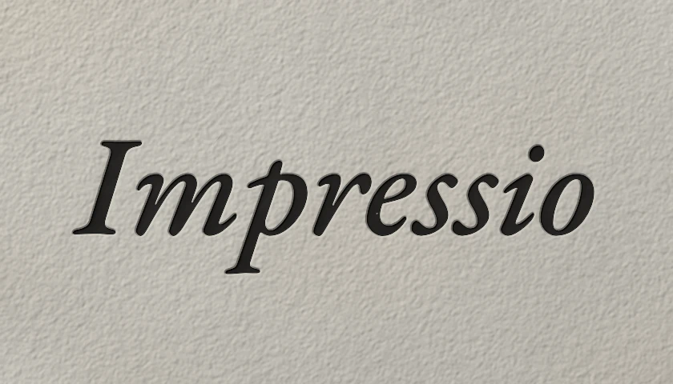</td>
<td>

**`cottonGrey`**

Warm grey cotton cover.

</td>
<td>

```ts
const sheet = createSheet({ width: 420,
  height: 240, paper: 'cottonGrey',
  seed: 7 });
sheet.impress('deep', f =>
  f.text('Impressio', 210, 146,
  { font: 'italic 500 88px "EB Garamond"',
  align: 'center' }));
sheet.render();
```

</td>
</tr>
<tr>
<td>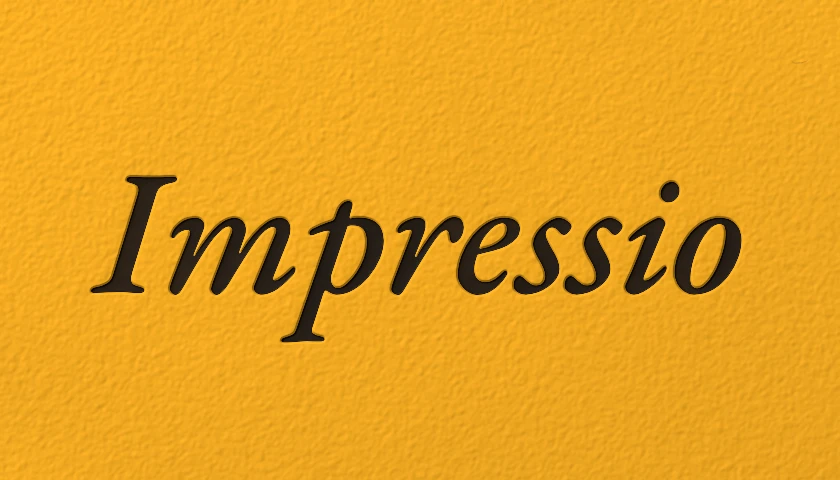</td>
<td>

**`cover`**

Dyed-through uncoated cover: firmer, with a finer tooth and a faint felt mark.

</td>
<td>

```ts
const sheet = createSheet({ width: 420,
  height: 240, paper: 'cover', seed: 7 });
sheet.impress('deep', f =>
  f.text('Impressio', 210, 146,
  { font: 'italic 500 88px "EB Garamond"',
  align: 'center' }));
sheet.render();
```

</td>
</tr>
<tr>
<td></td>
<td>

**`handmade`**

Handmade rag: heavy tooth, felt marks, cockle, visible fibres and a deckle edge (the picture has a transparent edge).

</td>
<td>

```ts
const sheet = createSheet({ width: 420,
  height: 240, paper: 'handmade',
  seed: 7 });
sheet.impress('deep', f =>
  f.text('Impressio', 210, 146,
  { font: 'italic 500 88px "EB Garamond"',
  align: 'center' }));
sheet.render();
```

</td>
</tr>
<tr>
<td>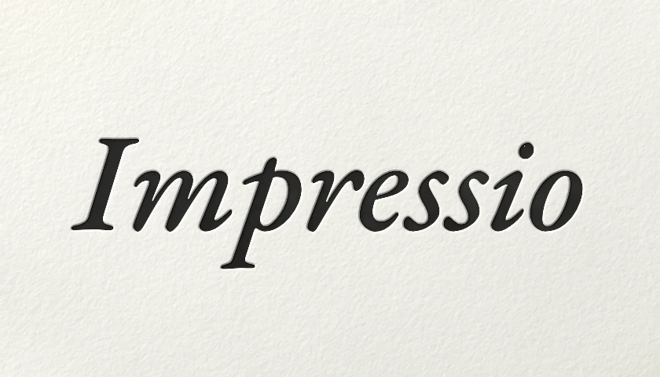</td>
<td>

**`cartridge`**

Smooth, hard poster cartridge. Takes little bite.

</td>
<td>

```ts
const sheet = createSheet({ width: 420,
  height: 240, paper: 'cartridge',
  seed: 7 });
sheet.impress('deep', f =>
  f.text('Impressio', 210, 146,
  { font: 'italic 500 88px "EB Garamond"',
  align: 'center' }));
sheet.render();
```

</td>
</tr>
<tr>
<td>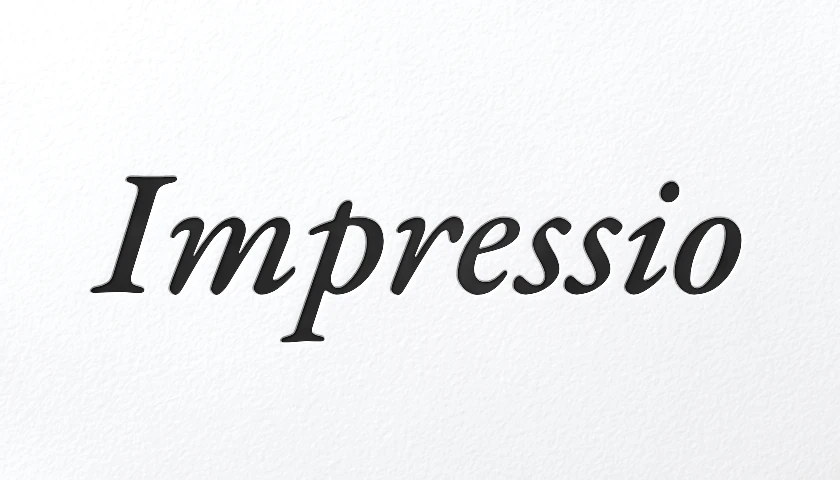</td>
<td>

**`a4`**

Ordinary 80 gsm printer paper: bright blue-white, nearly smooth, thin and hard.

</td>
<td>

```ts
const sheet = createSheet({ width: 420,
  height: 240, paper: 'a4', seed: 7 });
sheet.impress('deep', f =>
  f.text('Impressio', 210, 146,
  { font: 'italic 500 88px "EB Garamond"',
  align: 'center' }));
sheet.render();
```

</td>
</tr>
<tr>
<td>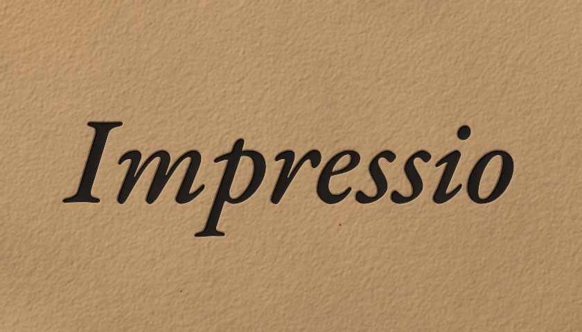</td>
<td>

**`kraft`**

Unbleached kraft, full of fibres and flecks.

</td>
<td>

```ts
const sheet = createSheet({ width: 420,
  height: 240, paper: 'kraft', seed: 7 });
sheet.impress('deep', f =>
  f.text('Impressio', 210, 146,
  { font: 'italic 500 88px "EB Garamond"',
  align: 'center' }));
sheet.render();
```

</td>
</tr>
<tr>
<td>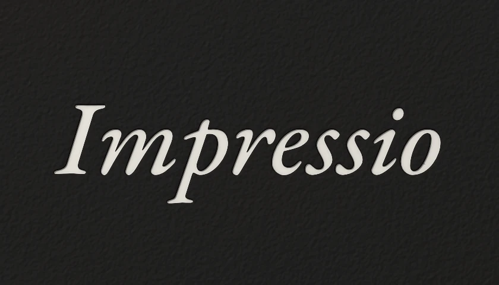</td>
<td>

**`black`**

Black cover stock, for opaque inks and foil.

</td>
<td>

```ts
const sheet = createSheet({ width: 420,
  height: 240, paper: 'black', seed: 7 });
sheet.impress({ ...impressions.deep,
  ink: 'white' }, f => f.text('Impressio',
  210, 146,
  { font: 'italic 500 88px "EB Garamond"',
  align: 'center' }));
sheet.render();
```

</td>
</tr>
<tr>
<td>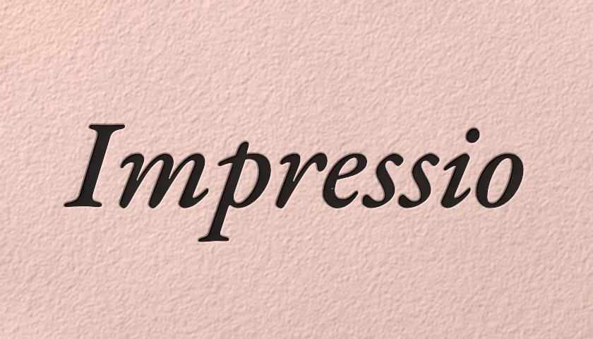</td>
<td>

**Any colour**

A CSS colour string gives the default stock in that colour.

</td>
<td>

```ts
const sheet = createSheet({ width: 420,
  height: 240, paper: '#e7c6bd', seed: 7 });
sheet.impress('deep', f =>
  f.text('Impressio', 210, 146,
  { font: 'italic 500 88px "EB Garamond"',
  align: 'center' }));
sheet.render();
```

</td>
</tr>
<tr>
<td>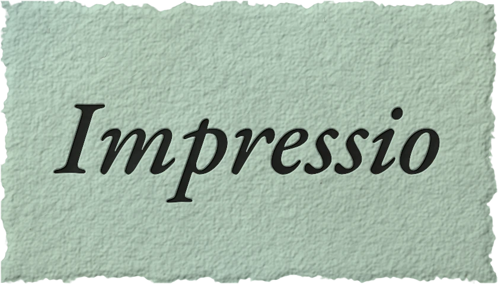</td>
<td>

**Custom `PaperSpec`**

Every property can be set: tooth and its scale, cloudiness (`formation`), `fibers`, `inclusions` (stray flecks), `softness`, `absorbency`, felt marks (`weave`), `cockle`, `deckle` edge and `sheen`.

</td>
<td>

```ts
const sheet = createSheet({ width: 420,
  height: 240, paper: { color: '#a9bfae',
  tooth: 0.85, toothScale: 2.6,
  formation: 1.2, fibers: 6,
  inclusions: 0.8, weave: 0.4, cockle: 0.6,
  deckle: 7 }, seed: 7 });
sheet.impress('deep', f =>
  f.text('Impressio', 210, 146,
  { font: 'italic 500 88px "EB Garamond"',
  align: 'center' }));
sheet.render();
```

</td>
</tr>
<tr>
<td>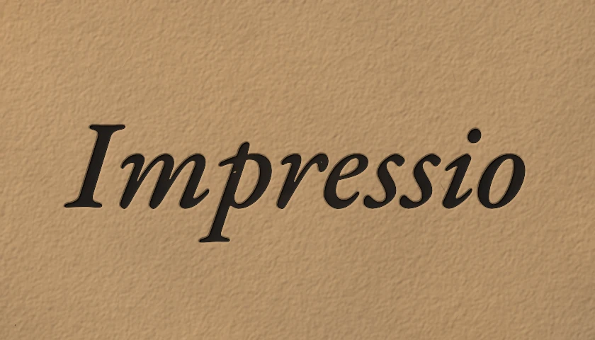</td>
<td>

**`seed`**

Every sheet is generated. The same seed reproduces the same sheet and print exactly; leave it out and every pull is unique.

</td>
<td>

```ts
const sheet = createSheet({ width: 420,
  height: 240, paper: 'kraft',
  seed: 1234 });
sheet.impress('deep', f =>
  f.text('Impressio', 210, 146,
  { font: 'italic 500 88px "EB Garamond"',
  align: 'center' }));
sheet.render();
```

</td>
</tr>
</table>

## Press runs

Presets in `impressions`; each call to `impress()` is one pass through the press.

<table>
<tr><th>Print<br>&nbsp;&nbsp;&nbsp;&nbsp;&nbsp;&nbsp;&nbsp;&nbsp;&nbsp;&nbsp;&nbsp;&nbsp;&nbsp;&nbsp;&nbsp;&nbsp;&nbsp;&nbsp;&nbsp;&nbsp;&nbsp;&nbsp;&nbsp;&nbsp;&nbsp;&nbsp;&nbsp;&nbsp;&nbsp;&nbsp;&nbsp;&nbsp;&nbsp;&nbsp;&nbsp;&nbsp;&nbsp;&nbsp;&nbsp;&nbsp;&nbsp;&nbsp;&nbsp;&nbsp;&nbsp;&nbsp;&nbsp;&nbsp;&nbsp;&nbsp;&nbsp;&nbsp;&nbsp;&nbsp;&nbsp;&nbsp;&nbsp;&nbsp;&nbsp;&nbsp;&nbsp;&nbsp;&nbsp;&nbsp;&nbsp;&nbsp;&nbsp;&nbsp;&nbsp;&nbsp;&nbsp;&nbsp;&nbsp;&nbsp;&nbsp;&nbsp;&nbsp;&nbsp;</th><th>What it shows<br>&nbsp;&nbsp;&nbsp;&nbsp;&nbsp;&nbsp;&nbsp;&nbsp;&nbsp;&nbsp;&nbsp;&nbsp;&nbsp;&nbsp;&nbsp;&nbsp;&nbsp;&nbsp;&nbsp;&nbsp;&nbsp;&nbsp;&nbsp;&nbsp;&nbsp;&nbsp;&nbsp;&nbsp;&nbsp;&nbsp;&nbsp;&nbsp;&nbsp;&nbsp;&nbsp;&nbsp;&nbsp;&nbsp;&nbsp;&nbsp;</th><th>Code</th></tr>
<tr>
<td></td>
<td>

**`deep`**

Photopolymer plate pressed hard into soft paper: crisp, dark and sculpted.

</td>
<td>

```ts
const sheet = createSheet({ width: 420,
  height: 240, paper: 'cotton', seed: 7 });
sheet.impress('deep', f =>
  f.text('Impressio', 210, 146,
  { font: 'italic 500 88px "EB Garamond"',
  align: 'center' }));
sheet.render();
```

</td>
</tr>
<tr>
<td>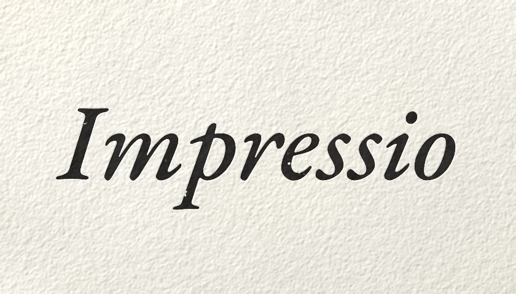</td>
<td>

**`kiss`**

Traditional kiss impression: the ink sits on the surface with barely any bite.

</td>
<td>

```ts
const sheet = createSheet({ width: 420,
  height: 240, paper: 'cotton', seed: 7 });
sheet.impress('kiss', f =>
  f.text('Impressio', 210, 146,
  { font: 'italic 500 88px "EB Garamond"',
  align: 'center' }));
sheet.render();
```

</td>
</tr>
<tr>
<td>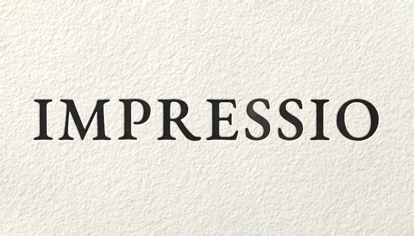</td>
<td>

**`handset`**

Hand-set metal type on a platen. With `handset: true` each letter is its own sort, so each sits and inks a little differently.

</td>
<td>

```ts
const sheet = createSheet({ width: 420,
  height: 240, paper: 'cotton', seed: 7 });
sheet.impress('handset', f =>
  f.text('IMPRESSIO', 210, 142,
    { font: '500 62px "EB Garamond"',
    align: 'center', tracking: 4,
    handset: true }));
sheet.render();
```

</td>
</tr>
<tr>
<td>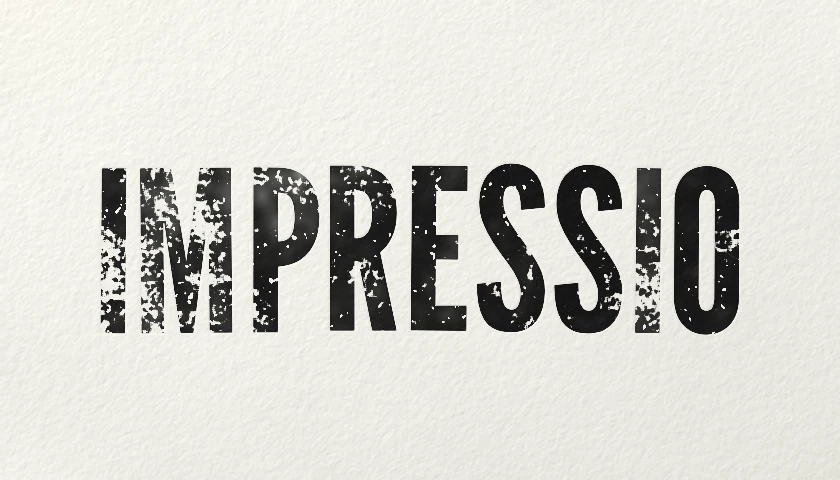</td>
<td>

**`woodType`**

Worn wood type inked with a hand brayer on a proof press: salty, scratched and uneven from letter to letter.

</td>
<td>

```ts
const sheet = createSheet({ width: 420,
  height: 240, paper: 'cartridge',
  seed: 7 });
sheet.impress({ ...impressions.woodType,
  ink: 'posterBlack' }, f =>
  f.text('IMPRESSIO', 210, 166,
    { font: '112px "League Gothic"',
    align: 'center', handset: true,
    jitter: 0.5, tilt: 0.3 }));
sheet.render();
```

</td>
</tr>
<tr>
<td>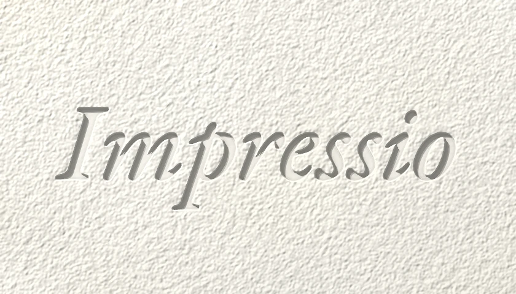</td>
<td>

**`blind`**

No ink at all: the forme is only pressed into the sheet.

</td>
<td>

```ts
const sheet = createSheet({ width: 420,
  height: 240, paper: 'cotton', seed: 7 });
sheet.impress('blind', f =>
  f.text('Impressio', 210, 146,
  { font: 'italic 500 88px "EB Garamond"',
  align: 'center' }));
sheet.render({ elevation: 24 });
```

</td>
</tr>
<tr>
<td>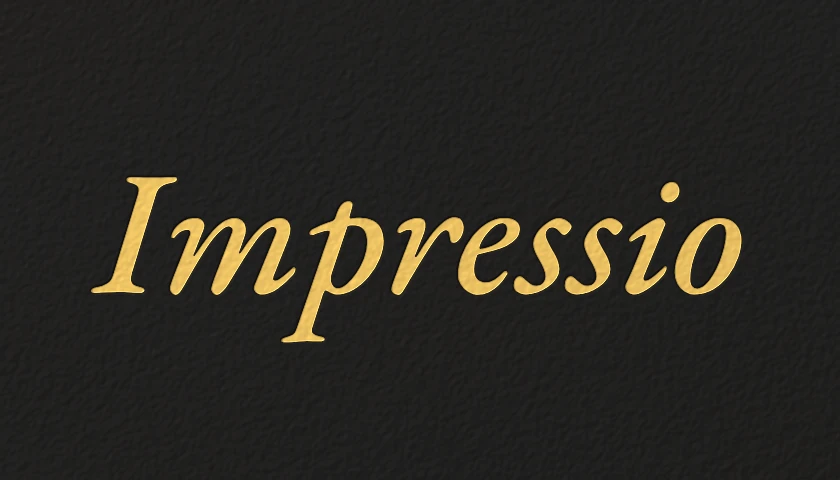</td>
<td>

**`foil`**

Hot foil stamping: shallow and perfectly solid, with a metallic film.

</td>
<td>

```ts
const sheet = createSheet({ width: 420,
  height: 240, paper: 'black', seed: 7 });
sheet.impress({ ...impressions.foil,
  ink: 'goldFoil' }, f =>
  f.text('Impressio', 210, 146,
  { font: 'italic 500 88px "EB Garamond"',
  align: 'center' }));
sheet.render();
```

</td>
</tr>
</table>

## Press parameters

Each picture prints the same forme twice, with a low value on the left and a high value on the right.

<table>
<tr><th>Print<br>&nbsp;&nbsp;&nbsp;&nbsp;&nbsp;&nbsp;&nbsp;&nbsp;&nbsp;&nbsp;&nbsp;&nbsp;&nbsp;&nbsp;&nbsp;&nbsp;&nbsp;&nbsp;&nbsp;&nbsp;&nbsp;&nbsp;&nbsp;&nbsp;&nbsp;&nbsp;&nbsp;&nbsp;&nbsp;&nbsp;&nbsp;&nbsp;&nbsp;&nbsp;&nbsp;&nbsp;&nbsp;&nbsp;&nbsp;&nbsp;&nbsp;&nbsp;&nbsp;&nbsp;&nbsp;&nbsp;&nbsp;&nbsp;&nbsp;&nbsp;&nbsp;&nbsp;&nbsp;&nbsp;&nbsp;&nbsp;&nbsp;&nbsp;&nbsp;&nbsp;&nbsp;&nbsp;&nbsp;&nbsp;&nbsp;&nbsp;&nbsp;&nbsp;&nbsp;&nbsp;&nbsp;&nbsp;&nbsp;&nbsp;&nbsp;&nbsp;&nbsp;&nbsp;</th><th>What it shows<br>&nbsp;&nbsp;&nbsp;&nbsp;&nbsp;&nbsp;&nbsp;&nbsp;&nbsp;&nbsp;&nbsp;&nbsp;&nbsp;&nbsp;&nbsp;&nbsp;&nbsp;&nbsp;&nbsp;&nbsp;&nbsp;&nbsp;&nbsp;&nbsp;&nbsp;&nbsp;&nbsp;&nbsp;&nbsp;&nbsp;&nbsp;&nbsp;&nbsp;&nbsp;&nbsp;&nbsp;&nbsp;&nbsp;&nbsp;&nbsp;</th><th>Code</th></tr>
<tr>
<td>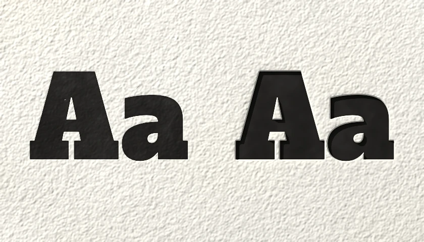</td>
<td>

**`depth`**

Bite: how far the forme sinks into the sheet, in px. The wall of the bite is a soft shoulder whose width follows the paper's `softness`.

</td>
<td>

```ts
const sheet = createSheet({ width: 420,
  height: 240, paper: 'cotton', seed: 7 });
const big = { font: '112px "Alfa Slab One"',
  align: 'center' };
const run = impressions.deep;
sheet.impress({ ...run, depth: 0.2 }, f =>
  f.text('Aa', 108, 158, big));
sheet.impress({ ...run, depth: 4 }, f =>
  f.text('Aa', 312, 158, big));
sheet.render({ elevation: 26 });
```

</td>
</tr>
<tr>
<td>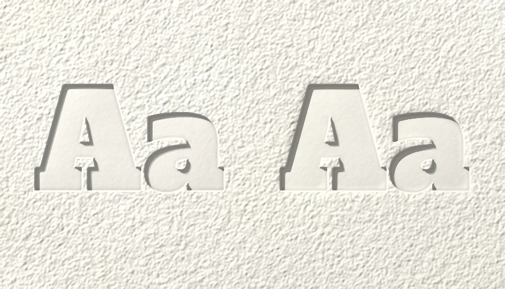</td>
<td>

**`dish`**

How much the paper around the bite is drawn down with it. Shown on a blind impression.

</td>
<td>

```ts
const sheet = createSheet({ width: 420,
  height: 240, paper: 'cotton', seed: 7 });
const big = { font: '112px "Alfa Slab One"',
  align: 'center' };
const run = impressions.deep;
sheet.impress({ ...run, ink: null, depth: 3,
  dish: 0 }, f => f.text('Aa', 108, 158,
  big));
sheet.impress({ ...run, ink: null, depth: 3,
  dish: 1 }, f => f.text('Aa', 312, 158,
  big));
sheet.render({ elevation: 22 });
```

</td>
</tr>
<tr>
<td>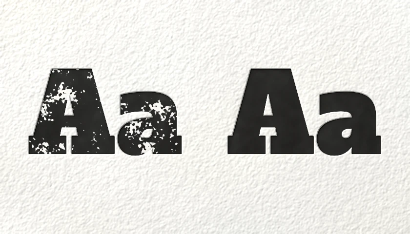</td>
<td>

**`contact`**

Completeness of contact. Below 1 only the high points of the paper meet the forme, leaving a salty print.

</td>
<td>

```ts
const sheet = createSheet({ width: 420,
  height: 240, paper: 'cottonWhite',
  seed: 7 });
const big = { font: '112px "Alfa Slab One"',
  align: 'center' };
const run = impressions.deep;
sheet.impress({ ...run, contact: 0.78 },
  f => f.text('Aa', 108, 158, big));
sheet.impress({ ...run, contact: 1.05 },
  f => f.text('Aa', 312, 158, big));
sheet.render();
```

</td>
</tr>
<tr>
<td>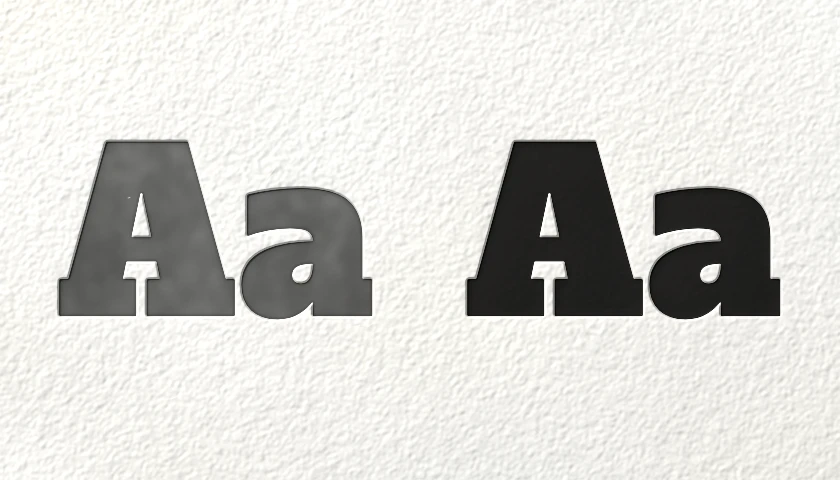</td>
<td>

**`inking`**

How much ink is on the forme: starved on the left, flooded on the right.

</td>
<td>

```ts
const sheet = createSheet({ width: 420,
  height: 240, paper: 'cottonWhite',
  seed: 7 });
const big = { font: '112px "Alfa Slab One"',
  align: 'center' };
const run = impressions.deep;
sheet.impress({ ...run, inking: 0.4 }, f =>
  f.text('Aa', 108, 158, big));
sheet.impress({ ...run, inking: 1.5 }, f =>
  f.text('Aa', 312, 158, big));
sheet.render();
```

</td>
</tr>
<tr>
<td>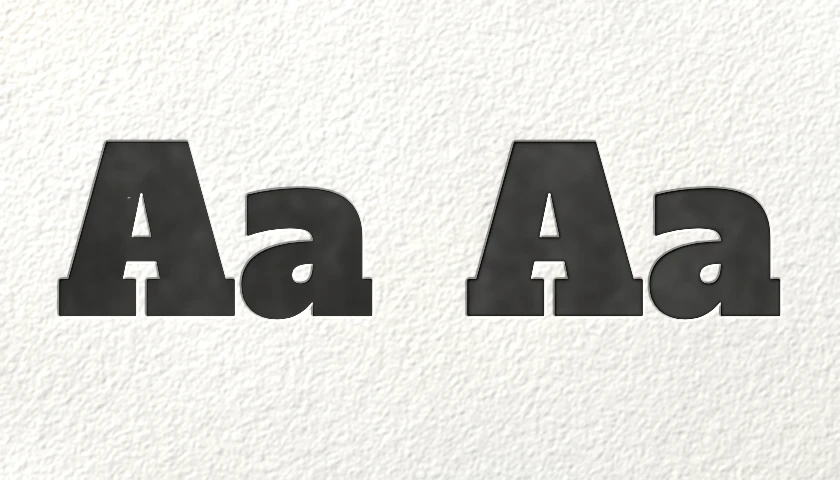</td>
<td>

**`squash`**

Ink squeezed to the edge of the face under pressure: a darker rim and a lighter centre.

</td>
<td>

```ts
const sheet = createSheet({ width: 420,
  height: 240, paper: 'cottonWhite',
  seed: 7 });
const big = { font: '112px "Alfa Slab One"',
  align: 'center' };
const run = impressions.deep;
sheet.impress({ ...run, inking: 0.7,
  squash: 0 }, f => f.text('Aa', 108, 158,
  big));
sheet.impress({ ...run, inking: 0.7,
  squash: 1 }, f => f.text('Aa', 312, 158,
  big));
sheet.render();
```

</td>
</tr>
<tr>
<td>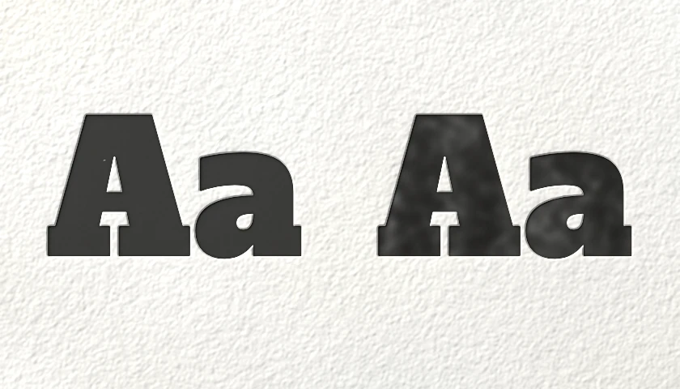</td>
<td>

**`mottle`**

Roller streaks and blotches inside solid areas, so black is never one flat black.

</td>
<td>

```ts
const sheet = createSheet({ width: 420,
  height: 240, paper: 'cottonWhite',
  seed: 7 });
const big = { font: '112px "Alfa Slab One"',
  align: 'center' };
const run = impressions.deep;
sheet.impress({ ...run, inking: 0.7,
  mottle: 0 }, f => f.text('Aa', 108, 158,
  big));
sheet.impress({ ...run, inking: 0.7,
  mottle: 1 }, f => f.text('Aa', 312, 158,
  big));
sheet.render();
```

</td>
</tr>
<tr>
<td>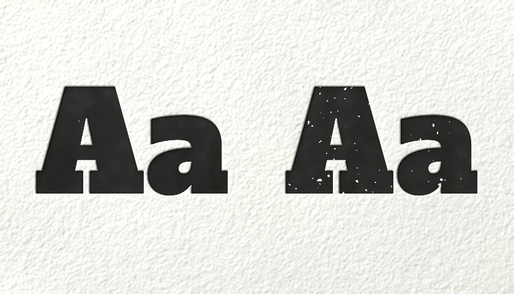</td>
<td>

**`wear`**

Damage to the printing surface: nicks, scratches and grain that print as missing ink.

</td>
<td>

```ts
const sheet = createSheet({ width: 420,
  height: 240, paper: 'cottonWhite',
  seed: 7 });
const big = { font: '112px "Alfa Slab One"',
  align: 'center' };
const run = impressions.deep;
sheet.impress({ ...run, wear: 0 }, f =>
  f.text('Aa', 108, 158, big));
sheet.impress({ ...run, wear: 1 }, f =>
  f.text('Aa', 312, 158, big));
sheet.render();
```

</td>
</tr>
<tr>
<td>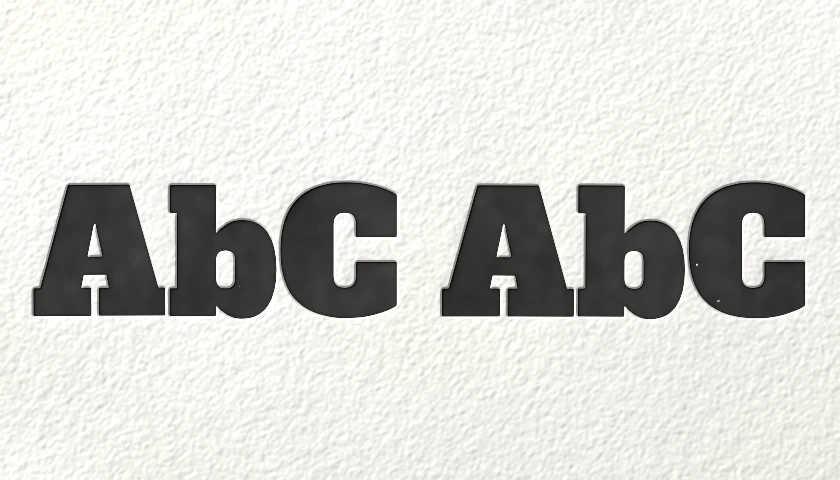</td>
<td>

**`sortVariation`**

How far individual sorts sit off type-high. With hand-set type some letters print darker and some lighter.

</td>
<td>

```ts
const sheet = createSheet({ width: 420,
  height: 240, paper: 'cottonWhite',
  seed: 7 });
const big = { font: '112px "Alfa Slab One"',
  align: 'center' };
const run = impressions.deep;
sheet.impress({ ...run, inking: 0.75,
  sortVariation: 0 }, f => f.text('AbC',
  108, 158, { ...big,
  font: '84px "Alfa Slab One"',
  handset: true }));
sheet.impress({ ...run, inking: 0.75,
  sortVariation: 1 }, f => f.text('AbC',
  312, 158, { ...big,
  font: '84px "Alfa Slab One"',
  handset: true }));
sheet.render();
```

</td>
</tr>
<tr>
<td>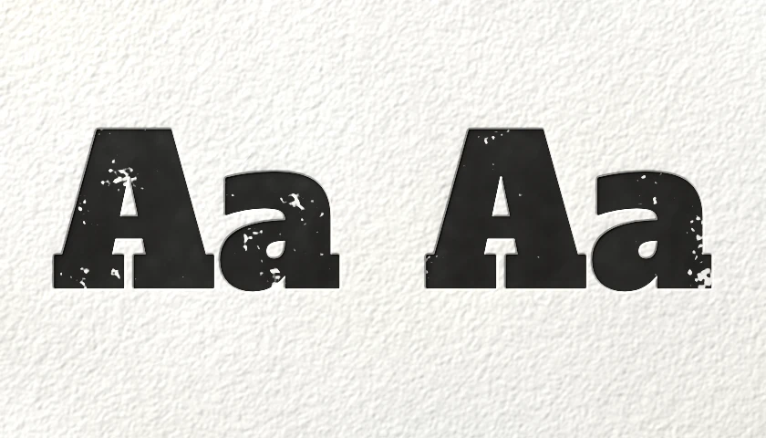</td>
<td>

**`makeready`**

Slow pressure variation across the bed, as with careless makeready. Shown with slightly low contact.

</td>
<td>

```ts
const sheet = createSheet({ width: 420,
  height: 240, paper: 'cottonWhite',
  seed: 7 });
const big = { font: '112px "Alfa Slab One"',
  align: 'center' };
const run = impressions.deep;
sheet.impress({ ...run, contact: 0.88,
  makeready: 0 }, f => f.text('Aa', 108,
  158, big));
sheet.impress({ ...run, contact: 0.88,
  makeready: 1 }, f => f.text('Aa', 312,
  158, big));
sheet.render();
```

</td>
</tr>
<tr>
<td>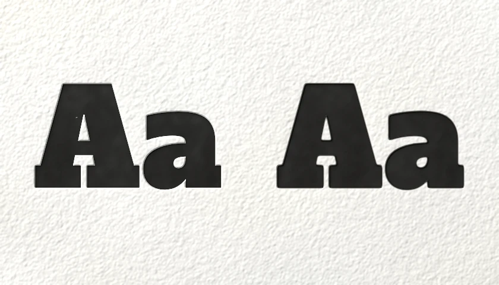</td>
<td>

**`gain`**

How far ink spreads beyond the edge of the face, in px.

</td>
<td>

```ts
const sheet = createSheet({ width: 420,
  height: 240, paper: 'cottonWhite',
  seed: 7 });
const big = { font: '112px "Alfa Slab One"',
  align: 'center' };
const run = impressions.deep;
sheet.impress({ ...run, gain: 0 }, f =>
  f.text('Aa', 108, 158, big));
sheet.impress({ ...run, gain: 1.5 }, f =>
  f.text('Aa', 312, 158, big));
sheet.render();
```

</td>
</tr>
<tr>
<td>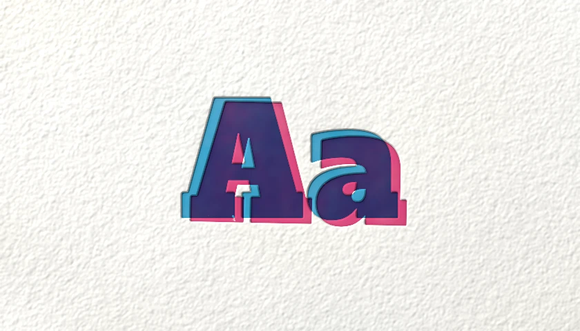</td>
<td>

**`register`**

Offset and rotation of one pass, for honest multi-colour work. Transparent inks mix where they overlap.

</td>
<td>

```ts
const sheet = createSheet({ width: 420,
  height: 240, paper: 'cottonWhite',
  seed: 7 });
const big = { font: '112px "Alfa Slab One"',
  align: 'center' };
const forme = f => f.text('Aa', 210, 158,
  big);
sheet.impress({ ...impressions.deep,
  ink: 'cyan' }, forme);
sheet.impress({ ...impressions.deep,
  ink: 'magenta', register: { x: 7, y: 4,
  rotate: 1.2 } }, forme);
sheet.render();
```

</td>
</tr>
</table>

## Inks

A named ink, any CSS colour, an `InkSpec`, or `null` for blind.

<table>
<tr><th>Print<br>&nbsp;&nbsp;&nbsp;&nbsp;&nbsp;&nbsp;&nbsp;&nbsp;&nbsp;&nbsp;&nbsp;&nbsp;&nbsp;&nbsp;&nbsp;&nbsp;&nbsp;&nbsp;&nbsp;&nbsp;&nbsp;&nbsp;&nbsp;&nbsp;&nbsp;&nbsp;&nbsp;&nbsp;&nbsp;&nbsp;&nbsp;&nbsp;&nbsp;&nbsp;&nbsp;&nbsp;&nbsp;&nbsp;&nbsp;&nbsp;&nbsp;&nbsp;&nbsp;&nbsp;&nbsp;&nbsp;&nbsp;&nbsp;&nbsp;&nbsp;&nbsp;&nbsp;&nbsp;&nbsp;&nbsp;&nbsp;&nbsp;&nbsp;&nbsp;&nbsp;&nbsp;&nbsp;&nbsp;&nbsp;&nbsp;&nbsp;&nbsp;&nbsp;&nbsp;&nbsp;&nbsp;&nbsp;&nbsp;&nbsp;&nbsp;&nbsp;&nbsp;&nbsp;</th><th>What it shows<br>&nbsp;&nbsp;&nbsp;&nbsp;&nbsp;&nbsp;&nbsp;&nbsp;&nbsp;&nbsp;&nbsp;&nbsp;&nbsp;&nbsp;&nbsp;&nbsp;&nbsp;&nbsp;&nbsp;&nbsp;&nbsp;&nbsp;&nbsp;&nbsp;&nbsp;&nbsp;&nbsp;&nbsp;&nbsp;&nbsp;&nbsp;&nbsp;&nbsp;&nbsp;&nbsp;&nbsp;&nbsp;&nbsp;&nbsp;&nbsp;</th><th>Code</th></tr>
<tr>
<td>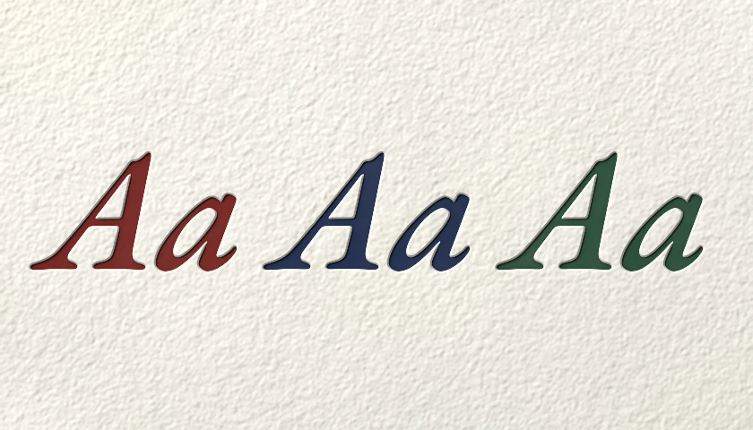</td>
<td>

**Named inks**

`black`, `posterBlack`, `warmGrey`, `oxblood`, `navy`, `forest`, the transparent `cyan` / `magenta` / `yellow`, opaque `white`, metallic `gold`, and `goldFoil` / `copperFoil` / `silverFoil`. Shown: oxblood, navy, forest.

</td>
<td>

```ts
const sheet = createSheet({ width: 420,
  height: 240, paper: 'cotton', seed: 7 });
const t = { font: 'italic 500 96px "EB Garamond"',
  align: 'center' };
['oxblood', 'navy', 'forest'].forEach((ink,
  i) =>
  sheet.impress({ ...impressions.deep,
    ink }, f => f.text('Aa', 80 + i * 130,
    150, t)));
sheet.render();
```

</td>
</tr>
<tr>
<td>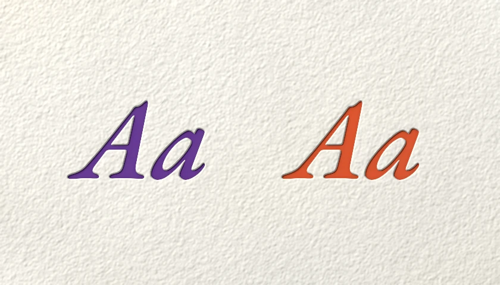</td>
<td>

**Any CSS colour**

A colour string is an ink. `ink(color, overrides)` builds one with its own properties.

</td>
<td>

```ts
const sheet = createSheet({ width: 420,
  height: 240, paper: 'cotton', seed: 7 });
const t = { font: 'italic 500 96px "EB Garamond"',
  align: 'center' };
sheet.impress({ ...impressions.deep,
  ink: 'rebeccapurple' }, f => f.text('Aa',
  120, 150, t));
sheet.impress({ ...impressions.deep,
  ink: ink('#e4572e', { gloss: 0.5 }) },
  f => f.text('Aa', 300, 150, t));
sheet.render();
```

</td>
</tr>
<tr>
<td>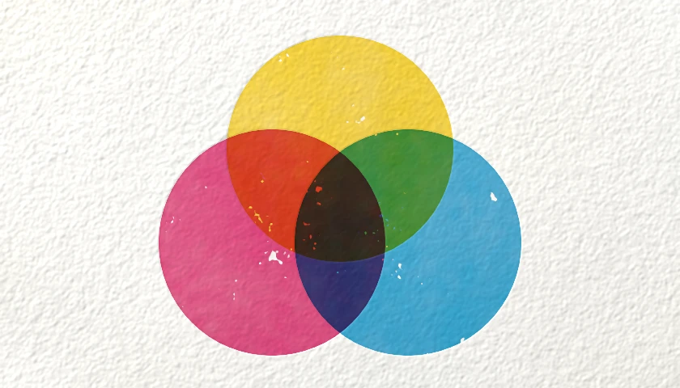</td>
<td>

**Transparent overprint**

Transparent pigment filters the light coming back off the paper, so overlapping passes mix as real inks do.

</td>
<td>

```ts
const sheet = createSheet({ width: 420,
  height: 240, paper: 'cottonWhite',
  seed: 7 });
const dot = (x, y) => f =>
  { f.ctx.beginPath(); f.ctx.arc(x, y, 70,
  0, 7); f.ctx.fill(); };
sheet.impress({ ...impressions.kiss,
  ink: 'yellow' }, dot(210, 92));
sheet.impress({ ...impressions.kiss,
  ink: 'magenta' }, dot(168, 150));
sheet.impress({ ...impressions.kiss,
  ink: 'cyan' }, dot(252, 150));
sheet.render();
```

</td>
</tr>
<tr>
<td>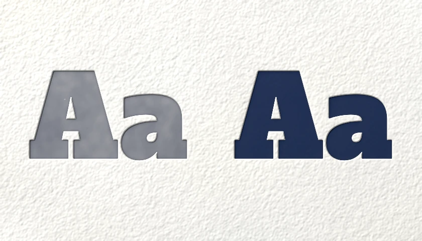</td>
<td>

**`strength`**

Pigment load: a pale tint on the left, a dense film on the right.

</td>
<td>

```ts
const sheet = createSheet({ width: 420,
  height: 240, paper: 'cottonWhite',
  seed: 7 });
const big = { font: '112px "Alfa Slab One"',
  align: 'center' };
sheet.impress({ ...impressions.deep,
  ink: ink('#1d2f55', { strength: 0.25 }) },
  f => f.text('Aa', 108, 158, big));
sheet.impress({ ...impressions.deep,
  ink: ink('#1d2f55', { strength: 1.6 }) },
  f => f.text('Aa', 312, 158, big));
sheet.render();
```

</td>
</tr>
<tr>
<td>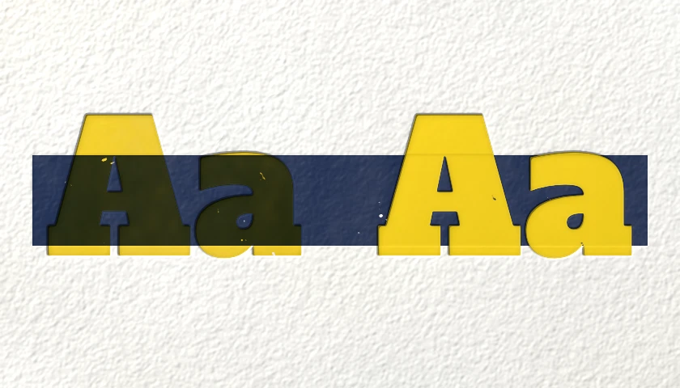</td>
<td>

**`opacity`**

Hiding power. Yellow printed over a navy bar: transparent on the left (it only tints), opaque on the right (it covers).

</td>
<td>

```ts
const sheet = createSheet({ width: 420,
  height: 240, paper: 'cottonWhite',
  seed: 7 });
const big = { font: '112px "Alfa Slab One"',
  align: 'center' };
sheet.impress({ ...impressions.kiss,
  ink: 'navy' }, f => f.rule(20, 96, 380,
  56));
sheet.impress({ ...impressions.deep,
  ink: ink('#f6d21d', { opacity: 0 }) },
  f => f.text('Aa', 108, 158, big));
sheet.impress({ ...impressions.deep,
  ink: ink('#f6d21d', { opacity: 1 }) },
  f => f.text('Aa', 312, 158, big));
sheet.render();
```

</td>
</tr>
<tr>
<td>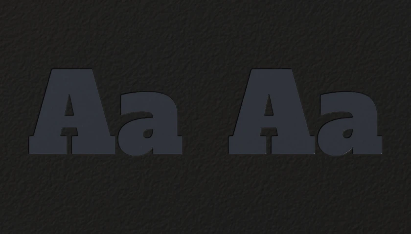</td>
<td>

**`gloss`**

Sheen of the dry film: matte on the left, glossy on the right. Most visible on dark stock under a low light.

</td>
<td>

```ts
const sheet = createSheet({ width: 420,
  height: 240, paper: 'black', seed: 7 });
const big = { font: '112px "Alfa Slab One"',
  align: 'center' };
sheet.impress({ ...impressions.foil,
  ink: ink('#30343c', { gloss: 0,
  opacity: 1 }) }, f => f.text('Aa', 108,
  158, big));
sheet.impress({ ...impressions.foil,
  ink: ink('#30343c', { gloss: 1,
  opacity: 1 }) }, f => f.text('Aa', 312,
  158, big));
sheet.render({ elevation: 30 });
```

</td>
</tr>
<tr>
<td>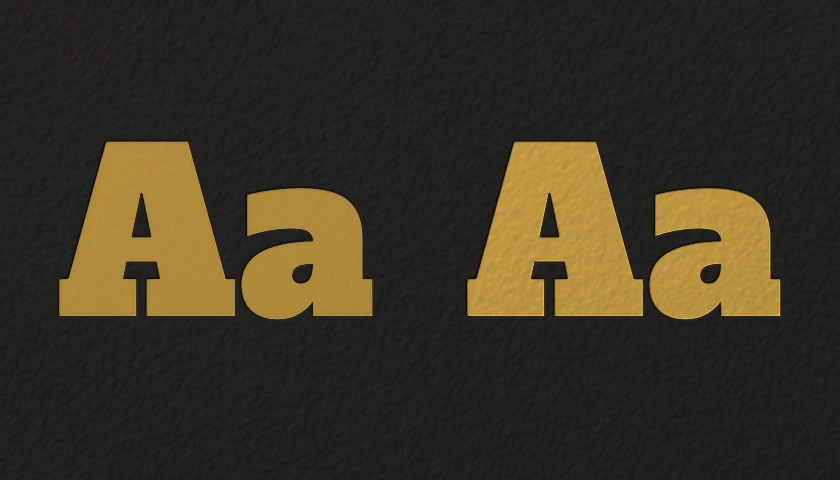</td>
<td>

**`metallic`**

Metallic reflection, for bronze inks and foil: plain pigment on the left, metal on the right.

</td>
<td>

```ts
const sheet = createSheet({ width: 420,
  height: 240, paper: 'black', seed: 7 });
const big = { font: '112px "Alfa Slab One"',
  align: 'center' };
const bronze = m => ink('#b08a3c',
  { opacity: 1, gloss: 0.6, metallic: m });
sheet.impress({ ...impressions.foil,
  ink: bronze(0) }, f => f.text('Aa', 108,
  158, big));
sheet.impress({ ...impressions.foil,
  ink: bronze(1) }, f => f.text('Aa', 312,
  158, big));
sheet.render();
```

</td>
</tr>
<tr>
<td>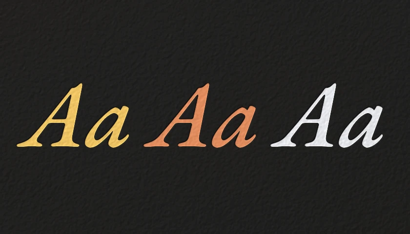</td>
<td>

**Foils**

Gold, copper and silver foil on black stock.

</td>
<td>

```ts
const sheet = createSheet({ width: 420,
  height: 240, paper: 'black', seed: 7 });
const t = { font: 'italic 500 96px "EB Garamond"',
  align: 'center' };
['goldFoil', 'copperFoil',
  'silverFoil'].forEach((ink, i) =>
  sheet.impress({ ...impressions.foil,
    ink }, f => f.text('Aa', 80 + i * 130,
    150, t)));
sheet.render();
```

</td>
</tr>
<tr>
<td>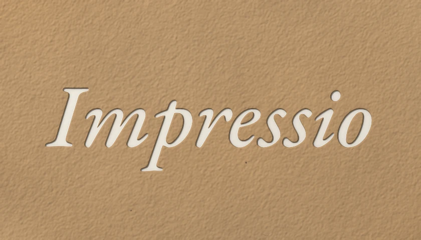</td>
<td>

**Opaque white**

An opaque ink covers a dark or coloured stock.

</td>
<td>

```ts
const sheet = createSheet({ width: 420,
  height: 240, paper: 'kraft', seed: 7 });
sheet.impress({ ...impressions.deep,
  ink: 'white' }, f => f.text('Impressio',
  210, 146,
  { font: 'italic 500 88px "EB Garamond"',
  align: 'center' }));
sheet.render();
```

</td>
</tr>
</table>

## Formes

A forme is a Canvas 2D context plus a few helpers. Anything drawn becomes printing surface.

<table>
<tr><th>Print<br>&nbsp;&nbsp;&nbsp;&nbsp;&nbsp;&nbsp;&nbsp;&nbsp;&nbsp;&nbsp;&nbsp;&nbsp;&nbsp;&nbsp;&nbsp;&nbsp;&nbsp;&nbsp;&nbsp;&nbsp;&nbsp;&nbsp;&nbsp;&nbsp;&nbsp;&nbsp;&nbsp;&nbsp;&nbsp;&nbsp;&nbsp;&nbsp;&nbsp;&nbsp;&nbsp;&nbsp;&nbsp;&nbsp;&nbsp;&nbsp;&nbsp;&nbsp;&nbsp;&nbsp;&nbsp;&nbsp;&nbsp;&nbsp;&nbsp;&nbsp;&nbsp;&nbsp;&nbsp;&nbsp;&nbsp;&nbsp;&nbsp;&nbsp;&nbsp;&nbsp;&nbsp;&nbsp;&nbsp;&nbsp;&nbsp;&nbsp;&nbsp;&nbsp;&nbsp;&nbsp;&nbsp;&nbsp;&nbsp;&nbsp;&nbsp;&nbsp;&nbsp;&nbsp;</th><th>What it shows<br>&nbsp;&nbsp;&nbsp;&nbsp;&nbsp;&nbsp;&nbsp;&nbsp;&nbsp;&nbsp;&nbsp;&nbsp;&nbsp;&nbsp;&nbsp;&nbsp;&nbsp;&nbsp;&nbsp;&nbsp;&nbsp;&nbsp;&nbsp;&nbsp;&nbsp;&nbsp;&nbsp;&nbsp;&nbsp;&nbsp;&nbsp;&nbsp;&nbsp;&nbsp;&nbsp;&nbsp;&nbsp;&nbsp;&nbsp;&nbsp;</th><th>Code</th></tr>
<tr>
<td>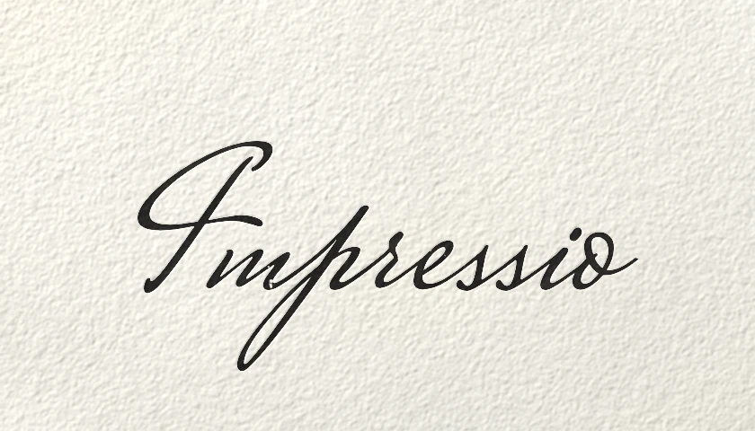</td>
<td>

**Any font**

Any font the page can render: CSS `@font-face`, web fonts, or a file registered with `loadFont(family, urlOrBuffer)`.

</td>
<td>

```ts
const sheet = createSheet({ width: 420,
  height: 240, paper: 'cotton', seed: 7 });
sheet.impress('kiss', f =>
  f.text('Impressio', 210, 160,
    { font: '110px "Mrs Saint Delafield"',
    align: 'center' }));
sheet.render();
```

</td>
</tr>
<tr>
<td>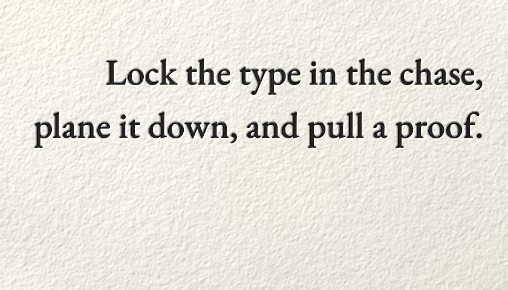</td>
<td>

**Lines, measure, alignment**

`\n` starts a new line, `maxWidth` wraps to a measure, `align` and `lineHeight` set the block.

</td>
<td>

```ts
const sheet = createSheet({ width: 420,
  height: 240, paper: 'cotton', seed: 7 });
sheet.impress('deep', f =>
  f.text('Lock the type in the chase, ' +
    'plane it down, and pull a proof.', 400,
      70,
    { font: '500 30px "EB Garamond"',
      align: 'right', maxWidth: 380,
      lineHeight: 44 }));
sheet.render();
```

</td>
</tr>
<tr>
<td>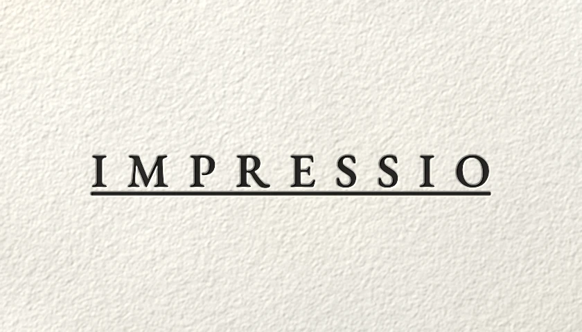</td>
<td>

**Letterspacing and underline**

`tracking` adds space between letters; `underline` prints a rule beneath the line.

</td>
<td>

```ts
const sheet = createSheet({ width: 420,
  height: 240, paper: 'cotton', seed: 7 });
sheet.impress('deep', f =>
  f.text('IMPRESSIO', 210, 135,
    { font: '500 34px "EB Garamond"',
    align: 'center', tracking: 14,
    underline: true }));
sheet.render();
```

</td>
</tr>
<tr>
<td></td>
<td>

**Hand-set slop**

`handset` sets each letter separately; `jitter` (px) and `tilt` (degrees) are how far each sort wanders. Exaggerated here.

</td>
<td>

```ts
const sheet = createSheet({ width: 420,
  height: 240, paper: 'cartridge',
  seed: 7 });
sheet.impress('woodType', f =>
  f.text('SORTS', 210, 172,
    { font: '140px "League Gothic"',
    align: 'center', handset: true,
    jitter: 2.5, tilt: 3 }));
sheet.render();
```

</td>
</tr>
<tr>
<td>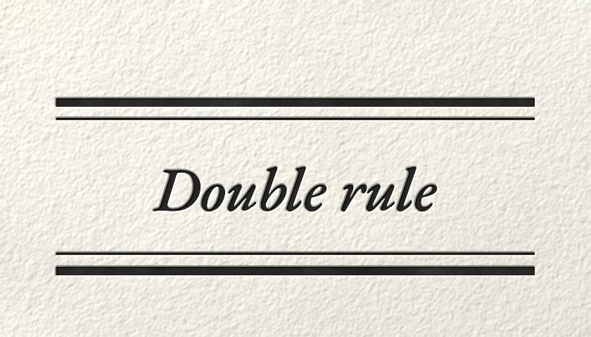</td>
<td>

**Rules**

`rule(x, y, width, height)` prints a brass rule or any solid rectangle.

</td>
<td>

```ts
const sheet = createSheet({ width: 420,
  height: 240, paper: 'cotton', seed: 7 });
sheet.impress('deep', f => {
  f.rule(40, 70, 340, 6); f.rule(40, 84,
    340, 1.5);
  f.text('Double rule', 210, 150,
    { font: 'italic 500 44px "EB Garamond"',
    align: 'center' });
  f.rule(40, 180, 340, 1.5); f.rule(40, 190,
    340, 6);
});
sheet.render();
```

</td>
</tr>
<tr>
<td>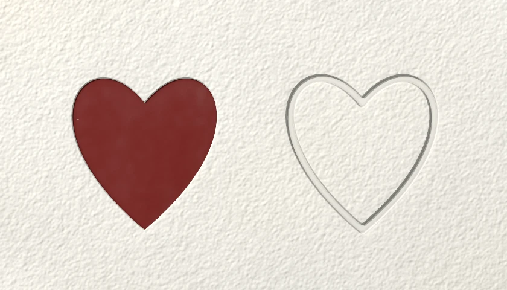</td>
<td>

**Vector cuts**

`path(d, { x, y, scale, stroke })` prints SVG path data or a `Path2D`, filled or stroked.

</td>
<td>

```ts
const sheet = createSheet({ width: 420,
  height: 240, paper: 'cotton', seed: 7 });
const heart = 'M0 -18 C-25 -50 -60 -10 0 40 ' +
  'C60 -10 25 -50 0 -18 Z';
sheet.impress({ ...impressions.deep,
  ink: 'oxblood' }, f => f.path(heart,
  { x: 120, y: 118, scale: 1.8 }));
sheet.impress('blind', f => f.path(heart,
  { x: 300, y: 118, scale: 1.8,
  stroke: 3 }));
sheet.render();
```

</td>
</tr>
<tr>
<td>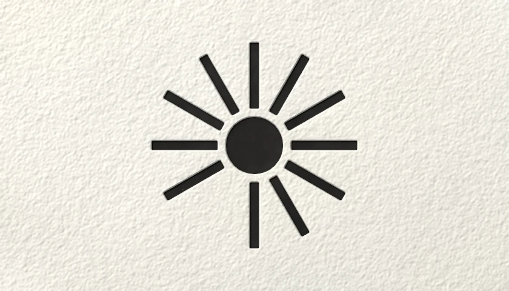</td>
<td>

**Image cuts**

`image(source, x, y, w, h)` prints any image, canvas or bitmap; its alpha channel is the printing surface.

</td>
<td>

```ts
const sheet = createSheet({ width: 420,
  height: 240, paper: 'cotton', seed: 7 });
const cut = document.createElement('canvas');
cut.width = cut.height = 200;
const c = cut.getContext('2d');
c.translate(100, 100);
for (let i = 0; i < 12; i++) {
  c.rotate(Math.PI / 6);
  c.fillRect(-4, 34, 8, 60);
}
c.beginPath(); c.arc(0, 0, 26, 0,
  7); c.fill();
sheet.impress('deep', f => f.image(cut, 120,
  30, 180, 180));
sheet.render();
```

</td>
</tr>
<tr>
<td>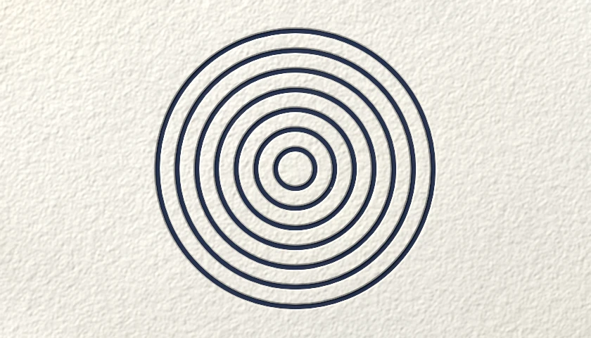</td>
<td>

**Raw Canvas 2D**

`f.ctx` is the real context, so any drawing code works. Colour is ignored; coverage is what prints.

</td>
<td>

```ts
const sheet = createSheet({ width: 420,
  height: 240, paper: 'cotton', seed: 7 });
sheet.impress({ ...impressions.deep,
  ink: 'navy' }, f => {
  f.ctx.lineWidth = 3;
  for (let r = 14; r < 100; r += 14) {
    f.ctx.beginPath();
    f.ctx.arc(210, 120, r, 0, 7);
    f.ctx.stroke();
  }
});
sheet.render();
```

</td>
</tr>
<tr>
<td>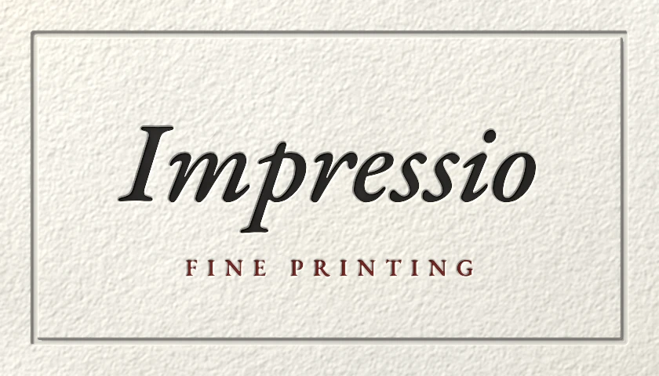</td>
<td>

**Several passes**

Call `impress()` as often as you like: blind ornaments, a second colour, foil on top.

</td>
<td>

```ts
const sheet = createSheet({ width: 420,
  height: 240, paper: 'cotton', seed: 7 });
sheet.impress('blind', f =>
  { f.ctx.lineWidth = 3; f.ctx.strokeRect(22,
  22, 376, 196); });
sheet.impress('deep', f =>
  f.text('Impressio', 210, 128,
  { font: 'italic 500 72px "EB Garamond"',
  align: 'center' }));
sheet.impress({ ...impressions.deep,
  depth: 1.2, ink: 'oxblood' }, f =>
  f.text('FINE PRINTING', 210, 176,
    { font: '500 15px "EB Garamond"',
    align: 'center', tracking: 6 }));
sheet.render();
```

</td>
</tr>
</table>

## Mathematics

LaTeX is typeset by MathJax's SVG output (or any engine given to `setTexEngine()`), and the outlines are printed.

<table>
<tr><th>Print<br>&nbsp;&nbsp;&nbsp;&nbsp;&nbsp;&nbsp;&nbsp;&nbsp;&nbsp;&nbsp;&nbsp;&nbsp;&nbsp;&nbsp;&nbsp;&nbsp;&nbsp;&nbsp;&nbsp;&nbsp;&nbsp;&nbsp;&nbsp;&nbsp;&nbsp;&nbsp;&nbsp;&nbsp;&nbsp;&nbsp;&nbsp;&nbsp;&nbsp;&nbsp;&nbsp;&nbsp;&nbsp;&nbsp;&nbsp;&nbsp;&nbsp;&nbsp;&nbsp;&nbsp;&nbsp;&nbsp;&nbsp;&nbsp;&nbsp;&nbsp;&nbsp;&nbsp;&nbsp;&nbsp;&nbsp;&nbsp;&nbsp;&nbsp;&nbsp;&nbsp;&nbsp;&nbsp;&nbsp;&nbsp;&nbsp;&nbsp;&nbsp;&nbsp;&nbsp;&nbsp;&nbsp;&nbsp;&nbsp;&nbsp;&nbsp;&nbsp;&nbsp;&nbsp;</th><th>What it shows<br>&nbsp;&nbsp;&nbsp;&nbsp;&nbsp;&nbsp;&nbsp;&nbsp;&nbsp;&nbsp;&nbsp;&nbsp;&nbsp;&nbsp;&nbsp;&nbsp;&nbsp;&nbsp;&nbsp;&nbsp;&nbsp;&nbsp;&nbsp;&nbsp;&nbsp;&nbsp;&nbsp;&nbsp;&nbsp;&nbsp;&nbsp;&nbsp;&nbsp;&nbsp;&nbsp;&nbsp;&nbsp;&nbsp;&nbsp;&nbsp;</th><th>Code</th></tr>
<tr>
<td>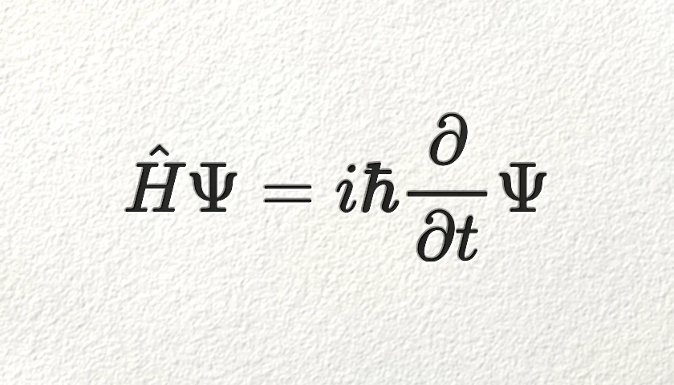</td>
<td>

**`typesetTex`**

One formula as a cut with a baseline. `f.cut(eq, x, baselineY, { align, scale })` places it.

</td>
<td>

```ts
const sheet = createSheet({ width: 420,
  height: 240, paper: 'cottonWhite',
  seed: 7 });
const eq = await typesetTex(
  '\\hat{H}\\Psi = i\\hbar' +
  '\\frac{\\partial}{\\partial t}\\Psi',
  { size: 44 });
sheet.impress('deep', f => f.cut(eq, 210,
  132, { align: 'center' }));
sheet.render();
```

</td>
</tr>
<tr>
<td>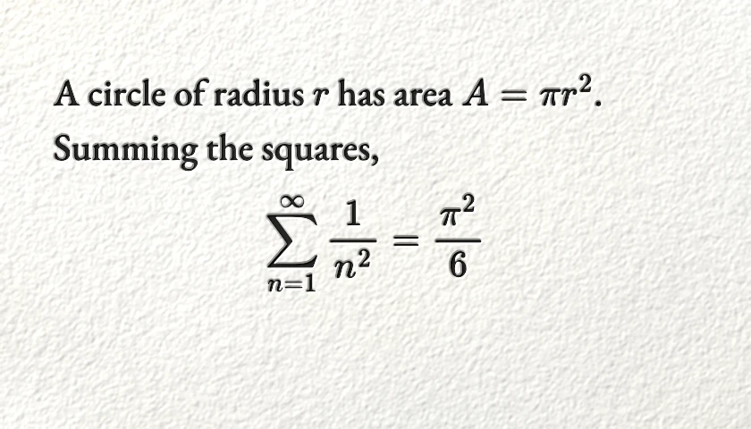</td>
<td>

**`typesetRich`**

Running text with maths: `$…$` sits inline on the baseline and wraps with the text, `$$…$$` takes its own centred line, `\$` is a dollar sign.

</td>
<td>

```ts
const sheet = createSheet({ width: 420,
  height: 240, paper: 'cottonWhite',
  seed: 7 });
const block = await typesetRich(
  'A circle of radius $r$ has area ' +
  '$A = \\pi r^{2}$. Summing the squares, ' +
  '$$\\sum_{n=1}^{\\infty} \\frac{1}{n^{2}}' +
  ' = \\frac{\\pi^{2}}{6}$$',
  { font: '500 21px "EB Garamond"',
    maxWidth: 360 });
sheet.impress('deep', f => f.block(block,
  30, 38));
sheet.render();
```

</td>
</tr>
</table>

## Light

`render(light)` re-photographs the sheet without redoing the press work, so the light can move freely.

<table>
<tr><th>Print<br>&nbsp;&nbsp;&nbsp;&nbsp;&nbsp;&nbsp;&nbsp;&nbsp;&nbsp;&nbsp;&nbsp;&nbsp;&nbsp;&nbsp;&nbsp;&nbsp;&nbsp;&nbsp;&nbsp;&nbsp;&nbsp;&nbsp;&nbsp;&nbsp;&nbsp;&nbsp;&nbsp;&nbsp;&nbsp;&nbsp;&nbsp;&nbsp;&nbsp;&nbsp;&nbsp;&nbsp;&nbsp;&nbsp;&nbsp;&nbsp;&nbsp;&nbsp;&nbsp;&nbsp;&nbsp;&nbsp;&nbsp;&nbsp;&nbsp;&nbsp;&nbsp;&nbsp;&nbsp;&nbsp;&nbsp;&nbsp;&nbsp;&nbsp;&nbsp;&nbsp;&nbsp;&nbsp;&nbsp;&nbsp;&nbsp;&nbsp;&nbsp;&nbsp;&nbsp;&nbsp;&nbsp;&nbsp;&nbsp;&nbsp;&nbsp;&nbsp;&nbsp;&nbsp;</th><th>What it shows<br>&nbsp;&nbsp;&nbsp;&nbsp;&nbsp;&nbsp;&nbsp;&nbsp;&nbsp;&nbsp;&nbsp;&nbsp;&nbsp;&nbsp;&nbsp;&nbsp;&nbsp;&nbsp;&nbsp;&nbsp;&nbsp;&nbsp;&nbsp;&nbsp;&nbsp;&nbsp;&nbsp;&nbsp;&nbsp;&nbsp;&nbsp;&nbsp;&nbsp;&nbsp;&nbsp;&nbsp;&nbsp;&nbsp;&nbsp;&nbsp;</th><th>Code</th></tr>
<tr>
<td></td>
<td>

**Raking light**

A low `elevation` rakes across the surface and exaggerates tooth and depth.

</td>
<td>

```ts
const sheet = createSheet({ width: 420,
  height: 240, paper: 'cotton', seed: 7 });
sheet.impress('deep', f =>
  f.text('Impressio', 210, 146,
  { font: 'italic 500 88px "EB Garamond"',
  align: 'center' }));
sheet.render({ azimuth: 315,
  elevation: 12 });
```

</td>
</tr>
<tr>
<td>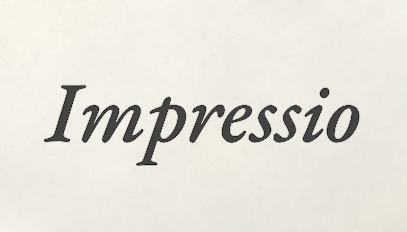</td>
<td>

**Overhead light**

A high `elevation` flattens the relief.

</td>
<td>

```ts
const sheet = createSheet({ width: 420,
  height: 240, paper: 'cotton', seed: 7 });
sheet.impress('deep', f =>
  f.text('Impressio', 210, 146,
  { font: 'italic 500 88px "EB Garamond"',
  align: 'center' }));
sheet.render({ elevation: 85 });
```

</td>
</tr>
<tr>
<td>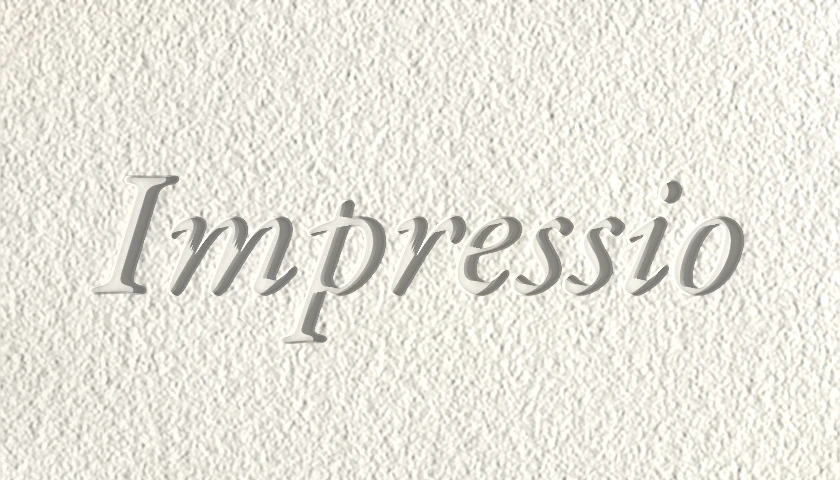</td>
<td>

**`azimuth`**

Where the light sits, in degrees clockwise from the top. Here it comes from the right.

</td>
<td>

```ts
const sheet = createSheet({ width: 420,
  height: 240, paper: 'cotton', seed: 7 });
sheet.impress('blind', f =>
  f.text('Impressio', 210, 146,
  { font: 'italic 500 88px "EB Garamond"',
  align: 'center' }));
sheet.render({ azimuth: 90,
  elevation: 22 });
```

</td>
</tr>
<tr>
<td></td>
<td>

**Colour and exposure**

`color` tints the light and `intensity` sets the exposure.

</td>
<td>

```ts
const sheet = createSheet({ width: 420,
  height: 240, paper: 'cotton', seed: 7 });
sheet.impress('deep', f =>
  f.text('Impressio', 210, 146,
  { font: 'italic 500 88px "EB Garamond"',
  align: 'center' }));
sheet.render({ color: '#ffd9a0',
  intensity: 0.92, elevation: 30 });
```

</td>
</tr>
<tr>
<td></td>
<td>

**Fill, shadow, cavity, falloff**

`ambient` fills the shadows, `shadow` and `occlusion` darken the bite, `falloff` darkens the side away from the light.

</td>
<td>

```ts
const sheet = createSheet({ width: 420,
  height: 240, paper: 'cotton', seed: 7 });
sheet.impress('blind', f =>
  f.text('Impressio', 210, 146,
  { font: 'italic 500 88px "EB Garamond"',
  align: 'center' }));
sheet.render({ elevation: 24, ambient: 0.1,
  shadow: 1, occlusion: 1, falloff: 0.4 });
```

</td>
</tr>
</table>

## Live DOM text

`pressElement()` prints an element's existing text onto a sheet placed behind it. The real text stays in the page, invisible but selectable, searchable and readable by assistive technology. CSS `color` is the ink; `data-ink` and `data-press` override it per element, `<hr>` and `[data-rule]` print as rules, `` and `<svg data-cut>` print as cuts, and underlines are printed as rules.

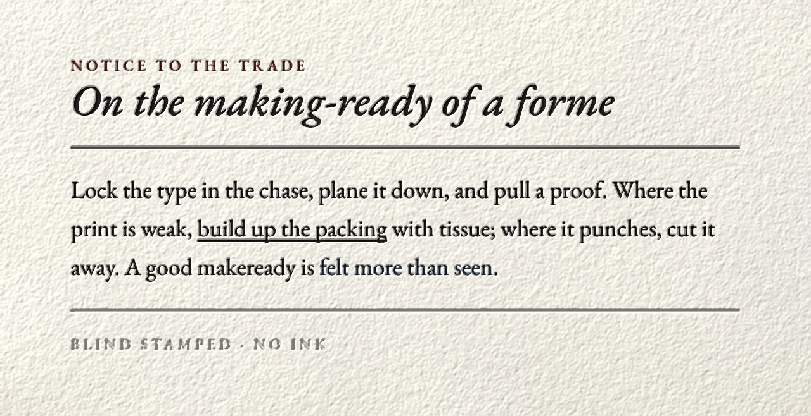

```html
<div class="card" style="font: 400 19px/1.6 'EB Garamond', Georgia, serif; color: #1b1a19; padding: 44px 56px 48px; box-sizing: border-box; width: 640px">
<p style="font: 500 12px/1.4 'EB Garamond'; letter-spacing: .22em; text-transform: uppercase; margin: 0" data-ink="oxblood">Notice to the trade</p>
<h3 style="font: italic 500 34px/1.1 'EB Garamond'; margin: 0 0 6px">On the making-ready of a forme</h3>
<hr style="border: 0; height: 1.5px; margin: 18px 0">
<p style="margin: 0">Lock the type in the chase, plane it down, and pull a proof. Where the print is weak, <u style="text-underline-offset: 3px">build up the packing</u> with tissue; where it punches, cut it away. A good makeready is <span data-ink="navy">felt more than seen</span>.</p>
<hr style="border: 0; height: 1.5px; margin: 18px 0" data-press="blind">
<p style="font: 500 12px/1.4 'EB Garamond'; letter-spacing: .22em; text-transform: uppercase; margin: 0" data-press="blind">Blind stamped · no ink</p>
</div>
```

```ts
import { pressElement } from 'impressio';

const pressed = await pressElement(document.querySelector('.card'), {
  paper: 'cotton', impression: 'deep', seed: 9, light: { azimuth: 315, elevation: 34 },
});
pressed.relight({ elevation: 20 }); // re-photograph
await pressed.update();             // after the content or size changes
pressed.destroy();                  // put the element back as it was
```

Pass `interactiveLight: true` to make the light follow the pointer, and `handset: true` to set each letter as its own sort.

## Also

| API | What it does |
| --- | --- |
| `loadFont(family, urlOrBuffer)` | Registers a font file so it can be named in a forme. |
| `fontsReady([...fonts])` | Waits until the given CSS fonts can be drawn on a canvas. |
| `setTexEngine(fn)` | Uses a TeX engine other than a global MathJax. |
| `setCanvasFactory(fn)` | Supplies a canvas constructor where there is no DOM. |
| `createSheet({ canvas, pixelRatio })` | Draws into an existing canvas, at a chosen device pixel ratio. |
| `sheet.toDataURL()` | Exports the current render. |
