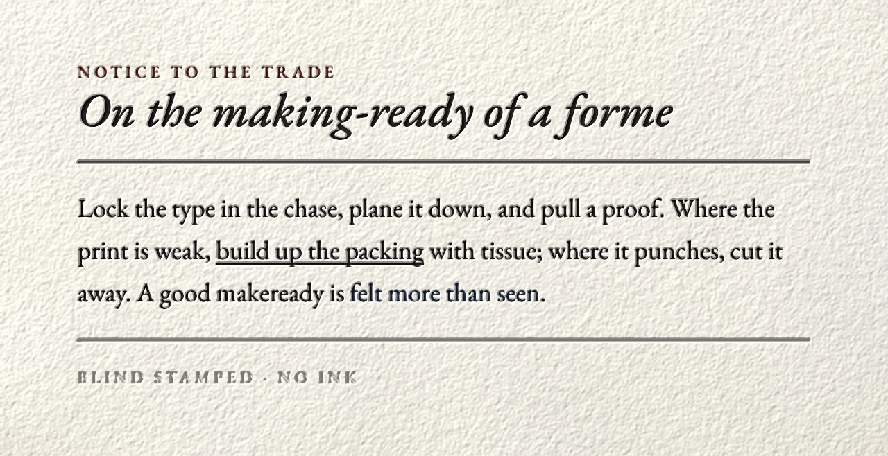

# Impressio

<p align="center">
  
</p>

<p align="center"><b><a href="GALLERY.md">Gallery: every feature, with a picture and the code that made it →</a></b></p>

Letterpress on cardstock, simulated. A TypeScript library (zero dependencies, ~20 kB minified)
that renders to a `<canvas>`. Nothing is a texture or an image: every sheet is generated, pressed,
inked and lit from a seed.

```ts
import { createSheet } from 'impressio';

const sheet = createSheet({ width: 720, height: 440, paper: 'cotton', seed: 7 });

sheet.impress('deep', f => {
  f.text('odile marchetti', 360, 200, { font: 'italic 96px "EB Garamond"', align: 'center' });
});
sheet.impress('blind', f => f.rule(180, 250, 360, 2));   // second pass, no ink

document.body.append(sheet.render({ azimuth: 315, elevation: 35 }));
```

Build: `npm install && npm run build` (outputs `dist/impressio.js` ESM, `dist/impressio.global.js`
IIFE exposing `Impressio`, and type declarations). Demo: `node demo/build.mjs`, then open `demo/index.html`.

## The model

A `Sheet` holds physical state, not pixels: a height field (the sheet's body plus its surface tooth),
a linear-light reflectance map, and gloss / metallic maps. Three stages act on it.

**Paper** (`papers.*`, or any `PaperSpec`)

| Effect | How it is made |
| --- | --- |
| Tooth | Band-limited noise at three scales, as relief; also decides where ink can reach |
| Non-uniform off-white | Low-frequency "formation" clouds in lightness, with a slight warm/cool drift |
| Fibres | Wandering strands of the furnish, a touch lighter or darker, standing slightly proud |
| Rare inclusions | A few dark or dyed flecks per sheet (`inclusions`, per 100x100 px) |
| Felt marks, cockle, deckle | Weave relief, large-scale waviness, and a torn feathered edge with alpha |

**Impression** (`impressions.*`, or any `ImpressionSpec`) — one call to `impress()` is one pass through the press.

| Parameter | Physical meaning |
| --- | --- |
| `depth` | Bite. Paper bends rather than shears, so walls are soft shoulders whose width follows the stock's `softness`. Pressure is force over area, so hairlines bite deeper than solids. The floor of the bite is calendered smooth. |
| `dish` | The sheet around the bite is drawn down with it, so type reads as sunk; displaced fibre shows on the back, not the front |
| `contact` | Below 1, only the high points of the paper meet the forme: the "salty" print of a light impression |
| `inking`, `mottle` | Film thickness, with brayer streaks and mottle, so solids are never one flat black |
| `squash` | Ink squeezed to the edge of the face: the dark rim of real letterpress, with a faint ridge |
| `sortVariation` | Each hand-set sort sits slightly off type-high, so each letter inks differently (`handset: true`) |
| `makeready` | Slow pressure unevenness across the bed |
| `wear` | Nicks, scratches and wood grain: missing printing surface |
| `gain` | Ink spread beyond the face |
| `register` | Offset and rotation of this pass, for honest multi-colour work |

Ink (`inks.*`, `ink('#c33')`, or any CSS colour) is a filter, not a fill: transparent pigment multiplies
the light coming back off the paper (so overprints mix), `opacity` adds hiding power, and `metallic` / `gloss`
give bronze inks and hot foil. `ink: null` or `'blind'` is an uninked deboss.

**Light** — `render(light)` computes normals from the height field, cast shadows into the bite,
cavity darkening, ink sheen and metallic reflection. It is cheap to call again, so the light can follow the pointer.

## Beyond a real press

- **Any font.** A forme is a Canvas 2D context: any font your page can render (`@font-face`, Google Fonts,
  `loadFont(name, urlOrBuffer)`), plus paths, images and SVG. Alpha is the printing face.
- **LaTeX.** `typesetTex(tex, { size })` typesets maths through MathJax's SVG output (load `tex-svg` with
  `svg.fontCache: 'none'`, or supply any engine with `setTexEngine()`), and returns a cut with a baseline:
  `f.cut(eq, x, baselineY, { align: 'center' })`. Maths already rendered on a page by MathJax SVG is picked
  up by `pressElement` automatically.
- **Type and maths together.** `typesetRich('The area is $A = \\pi r^2$ exactly.', { font, maxWidth })` lays out
  running text in your font with `$inline$` maths on the baseline and `$$display$$` maths on its own line,
  wrapping to a measure; place it with `f.block(block, x, y)`. `mathScale` matches the maths to a face's x-height.
- **Live DOM text.** `await pressElement(el, { paper: 'handmade' })` reprints an element's text onto a sheet
  behind it. The real text stays in place, invisible but selectable, searchable and accessible. CSS `color`
  becomes the ink; `data-ink`, `data-press`, `<hr>`, `[data-rule]` and `[data-cut]` give per-run control.
- **Stocks.** `papers` includes cotton, dyed cover, handmade, cartridge, kraft, black, and `a4`
  (ordinary 80 gsm printer paper: bright, smooth, thin and hard, so it takes little bite).
- **Deterministic.** The same `seed` reproduces the same sheet and press run; omit it and every pull is unique.
- **No DOM required for the core.** `setCanvasFactory()` accepts node-canvas style constructors.

## Limits

- Rendering is on the CPU: roughly 0.3–0.8 s to pull and print a 1–2 megapixel sheet, and tens of
  milliseconds to relight it. Fine for cards, headers and posters; not for a full scrolling page.
- `pressElement` draws word by word from browser layout, so justified text and kerning hold, but
  complex shaping that spans words is not reproduced, and `` must be same-origin.
- Untested outside Chromium so far.
